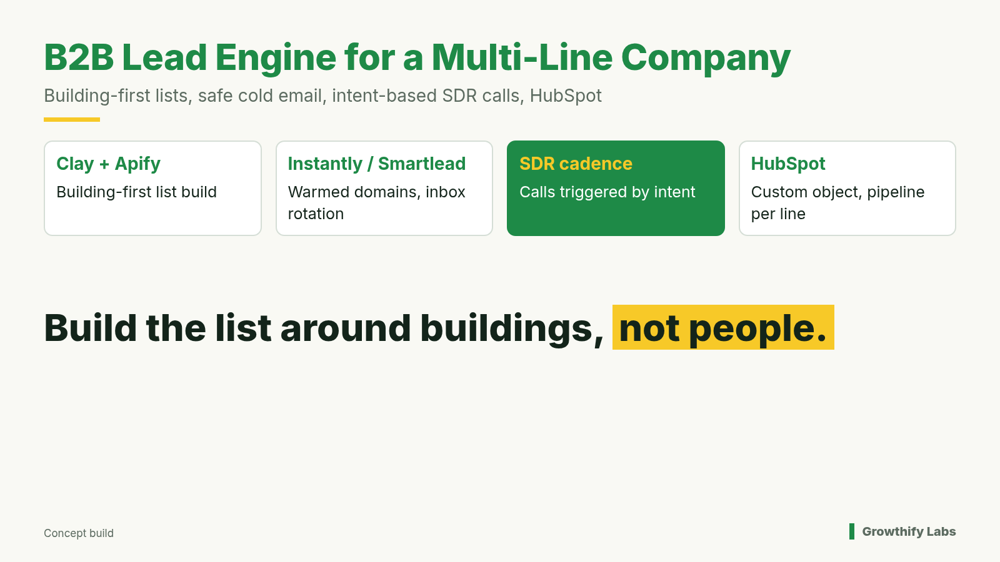
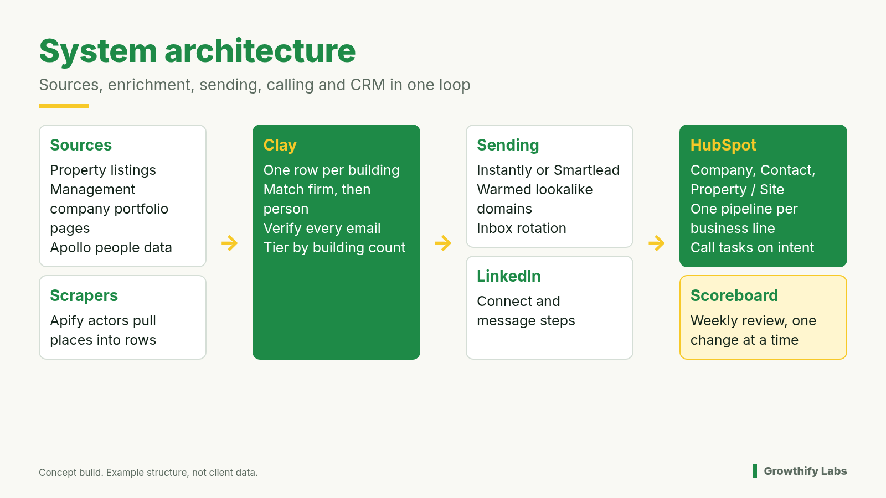
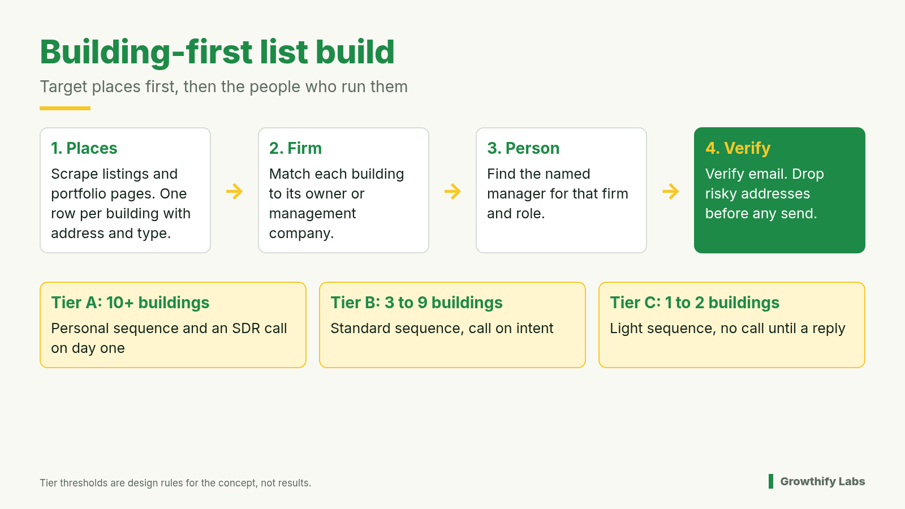
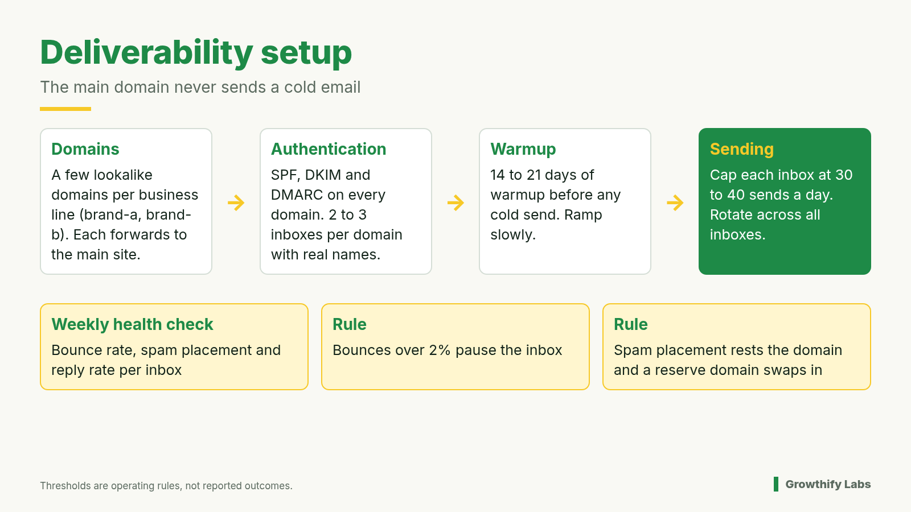
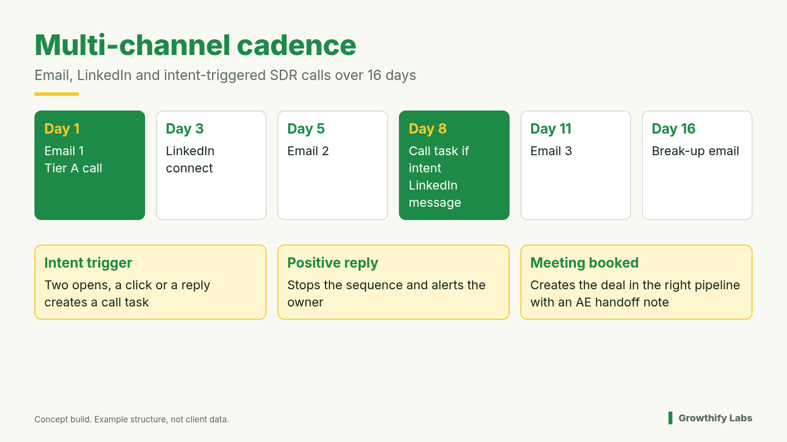
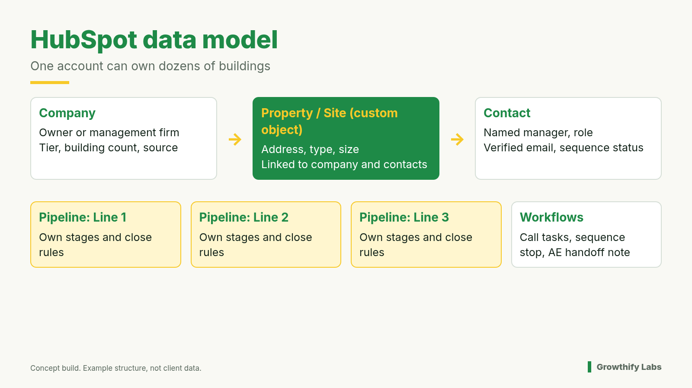
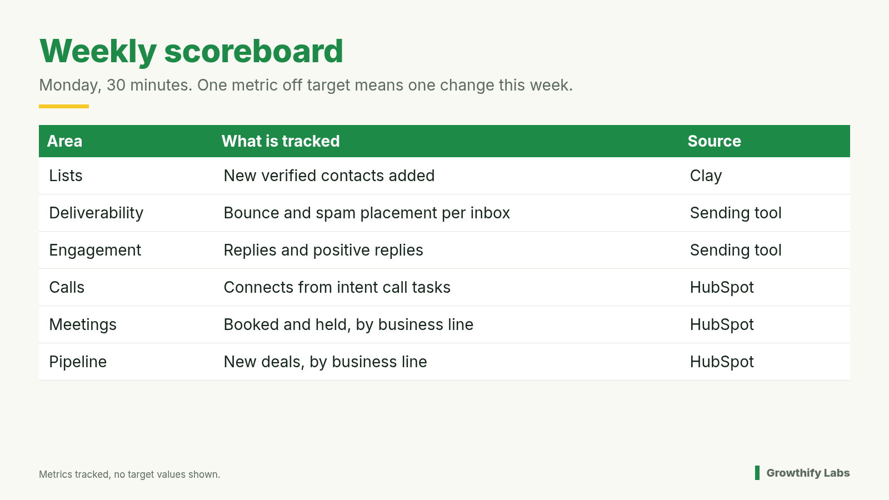

# B2B Lead Engine Blueprint

A building-first outbound system for a multi-line B2B company selling into commercial properties and multi-location accounts.

This is a concept build. It shows how I would design the system end to end. All thresholds below are design rules. Any table values are example data, not client results.

## 1. The problem

The company sells several business lines into buildings, branches and venues. SDRs are already dialing, but nobody owns the engine in front of them:

- **List building.** Lists are built from people, so nobody can see which buildings each person controls.
- **Deliverability.** Cold email risks the main domain.
- **Sequencing.** Calls go out from a cold spreadsheet instead of being timed to buyer intent.
- **CRM handoff.** Replies, meetings and deals don't land cleanly in HubSpot, and nobody can tell which business line is producing pipeline.

The goal is a steady feed of timed leads, plus one place to see pipeline by business line.

## 2. Architecture

| Layer | Tool | Job |
|---|---|---|
| Sources | Property listings, management company portfolio pages, Apollo | Find places and the people tied to them |
| Scraping | Apify | Pull places into structured rows |
| Enrichment | Clay | One row per building, match firm and person, verify email, tier |
| Sending | Instantly or Smartlead | Warmed lookalike domains, inbox rotation |
| Social | LinkedIn | Connect and message steps |
| CRM | HubSpot | Objects, pipelines, call tasks, handoff workflows |
| Review | Weekly scoreboard | One change per week |

## 3. Building-first list build

Apollo knows the property manager. It does not know which buildings they run. So the list starts with places.

1. **Places.** Scrape listings and management company portfolio pages. Each building gets one row with its address and type.
2. **Firm.** Match each building to its owner or management company.
3. **Person.** Find the named manager for that firm and role.
4. **Verify.** Verify every email and drop risky addresses before any send.

Then tier each firm by how many buildings it has:

| Tier | Building count | Treatment |
|---|---|---|
| A | 10 or more | Personal sequence and an SDR call on day one |
| B | 3 to 9 | Standard sequence, call on intent |
| C | 1 to 2 | Light sequence, no call until a reply |

The thresholds are design rules and can be tuned per business line.

## 4. Deliverability rules

- The main domain never sends a cold email.
- Buy a few lookalike domains per business line (example: brand-a, brand-b). Point each one at the main site.
- Set SPF, DKIM and DMARC on every domain.
- Set up 2 to 3 inboxes per domain with real names and signatures.
- Warm every inbox for 14 to 21 days before any cold send, and ramp slowly.
- Cap each inbox at 30 to 40 sends a day and rotate across all inboxes.
- Run a health check every week covering bounce rate, spam placement and reply rate per inbox.
- If bounces go over 2%, pause the inbox.
- If mail lands in spam, rest the domain and swap in a reserve domain.

## 5. Cadence

Example 16-day cadence:

| Day | Step |
|---|---|
| 1 | Email 1. Tier A also gets an SDR call. |
| 3 | LinkedIn connect |
| 5 | Email 2 |
| 8 | Call task if there is intent, plus a LinkedIn message |
| 11 | Email 3 |
| 16 | Break-up email |

Each business line gets its own message track, because each line solves a different problem for the same building.

## 6. SDR triggers

SDRs call on intent, not off a spreadsheet.

- Two opens, a click or a reply creates a HubSpot call task.
- A positive reply stops the sequence and alerts the owner.
- An unsubscribe or a "not interested" reply stops all steps and suppresses the contact.
- A booked meeting creates the deal in the right pipeline and hands the AE a note covering the building, the tier, the touches so far and the reply.

## 7. HubSpot data model

- **Company.** The owner or management firm, with its tier, building count and source.
- **Property / Site (custom object).** Address, type and size, linked to the company and its contacts. One account can own dozens of buildings, so buildings need their own records.
- **Contact.** The named manager and role, with verified email and sequence status.
- **Deals.** One pipeline per business line. Different lines close differently, so each line gets its own stages and close rules.
- **Workflows.** Intent call tasks, sequence stops on reply, and the AE handoff note on a booked meeting.

## 8. Weekly scoreboard

Review it every Monday for 30 minutes. If one metric is off target, make one change that week, never five.

| Area | What is tracked | Source |
|---|---|---|
| Lists | New verified contacts added | Clay |
| Deliverability | Bounce and spam placement per inbox | Sending tool |
| Engagement | Replies and positive replies | Sending tool |
| Calls | Connects from intent call tasks | HubSpot |
| Meetings | Booked and held, by business line | HubSpot |
| Pipeline | New deals, by business line | HubSpot |

Targets are set with the team once there is a baseline.

## 9. Roadmap phases

1. **Foundation.** Buy domains, set up authentication and start warmup. Build the HubSpot objects, pipelines and properties. Build the first building-first list for one business line.
2. **Launch.** Start sequences for one line at a time. Turn on the intent call tasks and the AE handoff. Hold the first scoreboard reviews.
3. **Expand.** Add the remaining business lines and new list sources. Tune the tier thresholds and the copy, one change at a time.
4. **Run and advise.** The team owns the daily work. The system builder moves to light advisory and the weekly review.

## 10. Risks

- **Domain reputation.** Mitigated by lookalike domains, warmup, send caps, weekly health checks and reserve domains.
- **Data quality.** Scraped building data can be stale or mismatched. Verify every email and spot check firm matches before sending.
- **Compliance.** Follow CAN-SPAM and the platform terms for each tool. Honor opt-outs everywhere, and check scraping sources' terms.
- **SDR adoption.** Calls only happen if call tasks are trusted. Keep triggers simple and review them weekly.
- **Too many changes at once.** The one-change rule keeps results readable.

---

Concept build by Growthify Labs. Numbers shown are design rules, not client results.

https://growthifylabs.ai/#assessment
